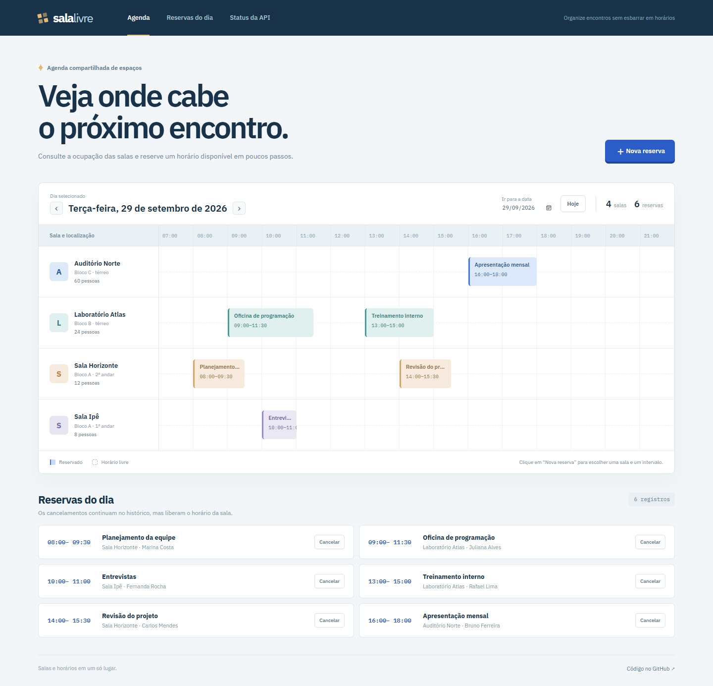
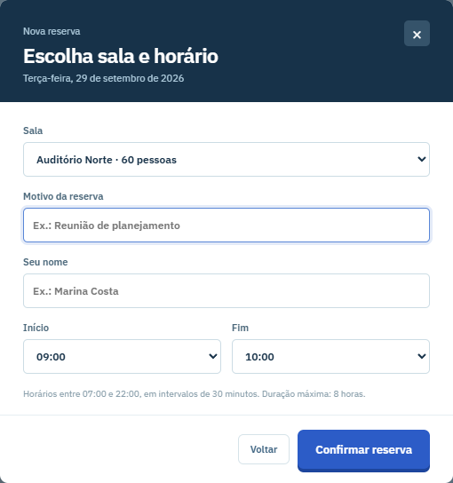

# Sala Livre

**A room booking board that prevents overlapping reservations.**

Sala Livre shows the day's occupancy across meeting rooms, labs, and an auditorium. Users can book a free slot or cancel a booking while keeping its history. The core business rule is implemented in Java and covered by HTTP integration tests.



## Features

- Browse the schedule by date and see the four starter rooms.
- Book a room for 30 minutes to 8 hours within 07:00–22:00, in half-hour increments.
- Reject overlapping active bookings while allowing adjacent slots.
- Cancel a booking, free its slot, and retain the cancelled record.
- Persist data in a local H2 database with versioned Flyway migrations.
- Serialize concurrent booking checks by locking the room row inside a transaction.



The mobile layout keeps the room board horizontally scrollable.


## Run locally

Requires **Java 21**. Maven Wrapper is included.

```bash
git clone https://github.com/FranklinDKz/sala-livre.git
cd sala-livre
./mvnw spring-boot:run
```

On Windows, use `.\mvnw.cmd spring-boot:run`. Open **http://localhost:8080**. The database is stored in the ignored `data/` directory. Four rooms are created on first run, while bookings start empty.

To load the **fictional bookings** shown in the screenshots, start with the `demo` profile: `SPRING_PROFILES_ACTIVE=demo ./mvnw spring-boot:run` on Linux/macOS, or set `$env:SPRING_PROFILES_ACTIVE = "demo"` before running the wrapper in PowerShell. It adds six bookings for the next day only when that day has no records.

Docker Compose is also available: `docker compose up --build`.

## API

| Method | Route | Purpose |
| --- | --- | --- |
| `GET` | `/api/rooms` | List rooms |
| `GET` | `/api/reservations?date=YYYY-MM-DD` | Daily schedule, including cancellations |
| `POST` | `/api/reservations` | Create a booking |
| `PATCH` | `/api/reservations/{id}/cancel` | Cancel a booking |
| `GET` | `/actuator/health` | Health check |

Example request; replace the date with a future day:

```bash
curl -X POST http://localhost:8080/api/reservations \
  -H "Content-Type: application/json" \
  -d '{"roomId":1,"title":"Planning meeting","requester":"Marina Costa","startsAt":"2030-05-17T09:00:00","endsAt":"2030-05-17T10:00:00"}'
```

Bookings use the server's local time. The browser sends the chosen date and time without timezone conversion.

## Stack and tests

Java 21, Spring Boot 4.1, Spring Web MVC, Spring Data JPA, Flyway, H2, JUnit 5, MockMvc, and plain HTML/CSS/JavaScript. Run `./mvnw verify` (or `.\mvnw.cmd verify` on Windows). GitHub Actions runs the build and tests on every push and pull request.

This is a local demonstration project. Authentication and per-user permissions would be needed before hosting a real shared schedule on the internet. Screenshot names are fictional.

**Franklin Dev** · [GitHub](https://github.com/FranklinDKz) · MIT License
