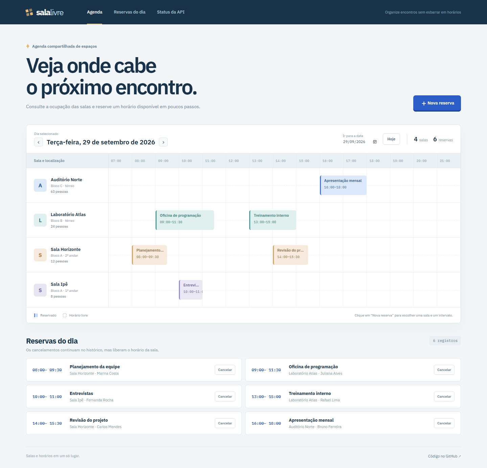
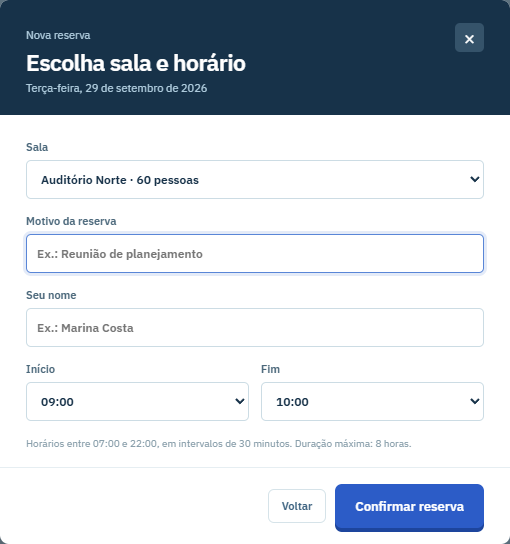
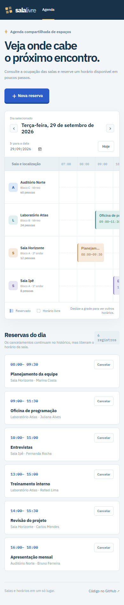

# Sala Livre

**Agenda de salas com reservas sem conflito de horários.**

Salas de reunião, laboratórios e auditórios costumam ser compartilhados por muita gente. O Sala Livre reúne a ocupação do dia em uma grade visual e impede que duas reservas ativas usem a mesma sala ao mesmo tempo. O projeto combina uma interface simples com uma API Java e regras de negócio testadas.

[Read in English](README.en.md)



## O que funciona

- Consulta da agenda por data, com quatro salas cadastradas inicialmente.
- Reserva com sala, motivo, responsável, início e fim.
- Bloqueio de horários sobrepostos. Reservas consecutivas, como 09:00–10:00 e 10:00–11:00, são permitidas.
- Cancelamento que libera o horário, mantendo o registro no histórico do dia.
- Validação de horários: mesmo dia, entre **07:00 e 22:00**, em blocos de **30 minutos**, com duração de **30 minutos a 8 horas**.
- API REST com respostas `400`, `404` e `409` para erros de validação, recurso ausente e conflito.
- Dados persistidos em H2 local e esquema controlado por migração Flyway.

O cadastro de reservas usa uma transação com bloqueio da linha da sala. Assim, duas solicitações simultâneas para a mesma sala são verificadas em sequência antes de gravar.



No celular, a grade pode ser deslizada na horizontal para consultar o restante do dia.



## Rodar localmente

É necessário **Java 21**. O projeto inclui o Maven Wrapper, então não é preciso instalar Maven separadamente.

```bash
git clone https://github.com/FranklinDKz/sala-livre.git
cd sala-livre
```

No Windows:

```powershell
.\mvnw.cmd spring-boot:run
```

No Linux ou macOS:

```bash
./mvnw spring-boot:run
```

Abra **http://localhost:8080**. O arquivo do banco fica em `data/` e não entra no Git. As quatro salas são criadas pela primeira migração; as reservas começam vazias.

### Carregar exemplos

As imagens usam **dados fictícios**. O perfil `demo` cria seis reservas para o dia seguinte, apenas se esse dia ainda não tiver registros.

No Windows PowerShell:

```powershell
$env:SPRING_PROFILES_ACTIVE = "demo"
.\mvnw.cmd spring-boot:run
```

No Linux ou macOS:

```bash
SPRING_PROFILES_ACTIVE=demo ./mvnw spring-boot:run
```

### Docker

```bash
docker compose up --build
```

O diretório `data/` é montado no contêiner para manter as reservas entre reinicializações.

## API

| Método | Rota | Uso |
| --- | --- | --- |
| `GET` | `/api/rooms` | Lista as salas e suas capacidades |
| `GET` | `/api/reservations?date=AAAA-MM-DD` | Lista reservas ativas e canceladas do dia |
| `POST` | `/api/reservations` | Cria uma reserva |
| `PATCH` | `/api/reservations/{id}/cancel` | Cancela uma reserva |
| `GET` | `/actuator/health` | Estado da aplicação |

Exemplo de criação; substitua a data por um dia futuro:

```bash
curl -X POST http://localhost:8080/api/reservations \
  -H "Content-Type: application/json" \
  -d '{"roomId":1,"title":"Reunião de planejamento","requester":"Marina Costa","startsAt":"2030-05-17T09:00:00","endsAt":"2030-05-17T10:00:00"}'
```

O horário segue o relógio local do servidor. O painel envia a data e hora escolhidas sem conversão de fuso.

## Estrutura

```text
src/main/java/dev/franklin/salalivre/
├── api/             # rotas e respostas de erro
├── reservation/     # regras de reserva e acesso aos dados
├── room/            # cadastro de salas
└── DemoDataConfiguration.java
src/main/resources/
├── db/migration/    # criação versionada das tabelas
└── static/          # painel HTML, CSS e JavaScript
src/test/            # testes HTTP com MockMvc
```

**Tecnologias:** Java 21, Spring Boot 4.1, Spring Web MVC, Spring Data JPA, Flyway, H2, JUnit 5 e MockMvc. O frontend não precisa de build separado.

## Testes

```bash
./mvnw verify
```

No Windows, use `.\mvnw.cmd verify`. Os testes cobrem salas iniciais, colisões de horário, intervalos consecutivos, cancelamento e respostas de erro. O GitHub Actions executa o build e os testes a cada push e pull request.

## Escopo

O projeto foi preparado para demonstração local. Antes de expor uma agenda real na internet, seriam necessários autenticação e permissões por usuário. Os nomes mostrados nas capturas são fictícios.

## Autor

**Franklin Dev** · [GitHub](https://github.com/FranklinDKz) · Licença MIT
